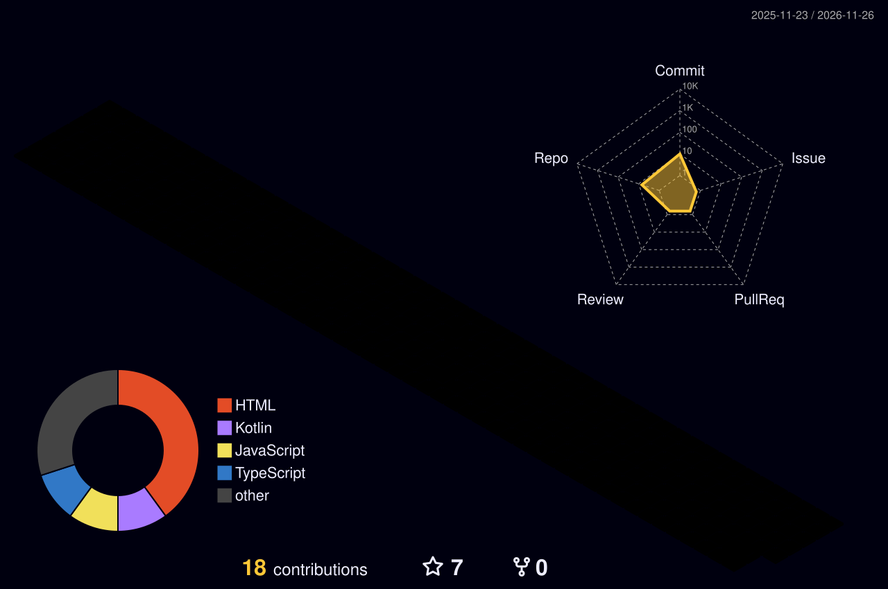

  <!-- Animated Neon Terminal Header -->
  

  <!-- Main GitHub Stats Card -->
  
  <!-- Top Languages Card -->
  

  <!-- Contribution Streak Bar -->
  

  <!-- 3D Isometric Contribution City -->
  

